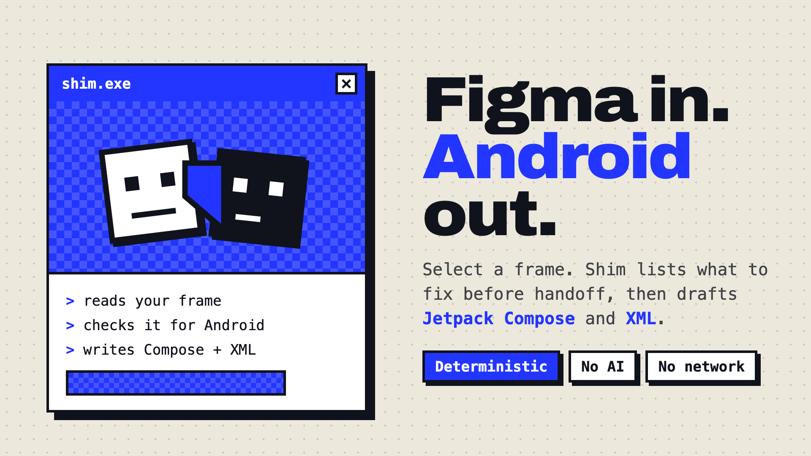
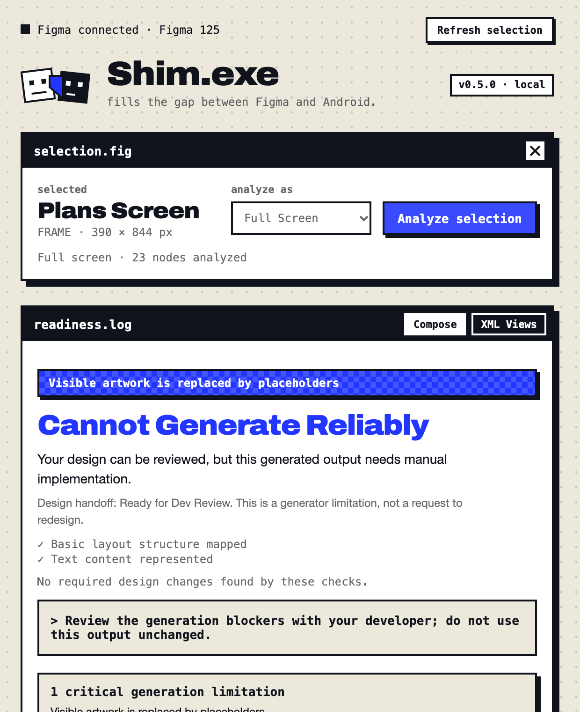
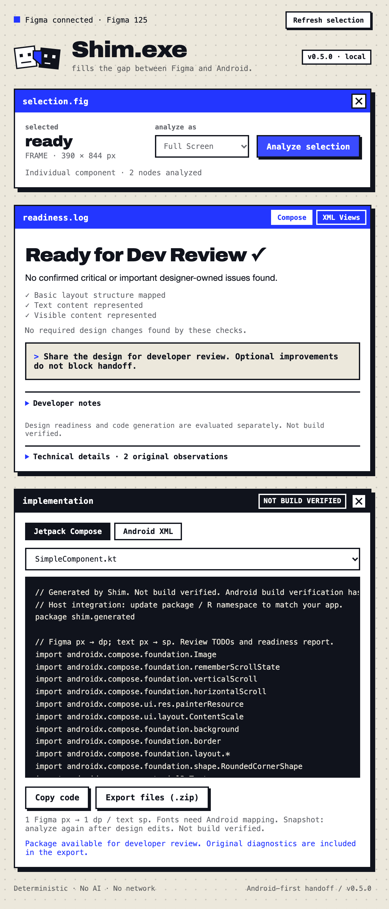

<p align="center"></p>

# Shim.exe

A Figma plugin that fills the gap between a design and Android code. Select a frame, press **Analyze**, and Shim tells you what to fix before handoff, then drafts **Jetpack Compose** and **Android XML** for it.

Deterministic generation. No AI or network access inside the Figma plugin. An optional local MCP adapter lets coding agents read an extracted handoff.

<p align="center">
  
  
</p>

## What it does

- **Readiness, per framework.** Compose and XML Views are judged separately, by what the generators can actually express. Verdicts: *Ready for Dev Review*, *Needs Attention*, *Cannot Generate Reliably*.
- **Actions, not noise.** Findings are grouped by cause and ranked. The top three show first, each with **Locate in Figma**, guidance, and technical details. Developer notes and generator limits stay collapsed.
- **Design vs. generator.** A limit of the code generator is never presented as a request to redesign.
- **Code and resources.** Compose and XML for the selection, layout and drawable resources, and real artwork exported as 2× PNG (`res/drawable-nodpi/`).
- **One zip.** Code, resources, source schema, readiness report, `HANDOFF.md`, an owner/priority task queue, and a file manifest.
- **Visual reference.** Native 1× Figma PNG in the ZIP, with capture time and bounds. Export failures are reported explicitly; Android visual fidelity still needs runtime review.
- **Agent handoff.** Optional read-only local MCP for readiness, layer lookup, and generated files. See [setup and workflow](docs/MCP.md).

1 Figma px becomes 1 dp (text px become sp).

## What it is not

The output is a **draft**. It is labelled *Not build verified* in the UI and in every export. Fonts need Android mapping, app behaviour is not inferred, and layers the generators cannot express (complex vectors, masks, some blends) become placeholders and are reported. See [docs/DETAILS.md](docs/DETAILS.md) for exactly what is supported and what was verified.

## Install (development plugin)

```bash
git clone https://github.com/namvunhatle/shim.git
cd shim
npm install
npm run build
```

In **Figma Desktop**: Plugins → Development → Import plugin from manifest… → choose `manifest.json`. Run it from Plugins → Development → Shim. Select one Frame, Component, Instance or Group, then press **Analyze selection**.

Close and reopen the plugin after each rebuild.

See [CHANGELOG.md](CHANGELOG.md) for changes and verification limits.

## Develop

```bash
npm run typecheck   # tsc --noEmit
npm test            # deterministic tests
npm run build       # bundles src/ into dist/code.js and dist/ui.html
npm run check       # all three
```

| Path | What |
|---|---|
| `src/main.ts` | Figma side: selection, export of artwork |
| `src/parser.ts`, `schema.ts` | Figma nodes into a normalized `AndroidUISchema` |
| `src/validator.ts`, `readiness.ts` | Findings, grouping, per-framework verdicts |
| `src/compose.ts`, `xml.ts` | Code generators |
| `src/ui.html`, `ui.ts`, `readiness-ui.ts` | The panel |
| `design/` | Visual direction notes and the Community listing assets |
| `docs/` | Implementation notes, audit history, images |

Two tests use a private real-world capture that is not part of this repository; they are skipped when the file is absent.

## Design

The UI follows the Stranger.exe look: bone paper, cobalt, square windows with hard shadows, Archivo for headings and monospace for system voice. The reasoning is in [design/DIRECTION.md](design/DIRECTION.md).

## License

[MIT](LICENSE). Third-party notes in [THIRD_PARTY.md](THIRD_PARTY.md).
